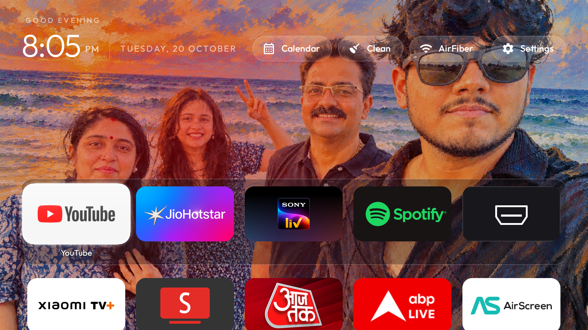
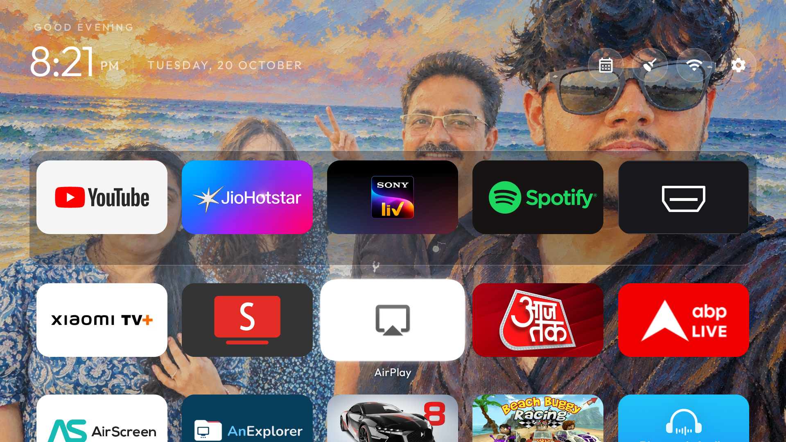
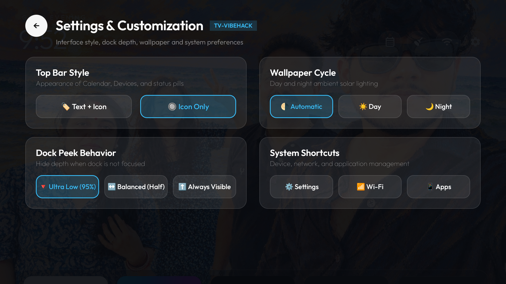
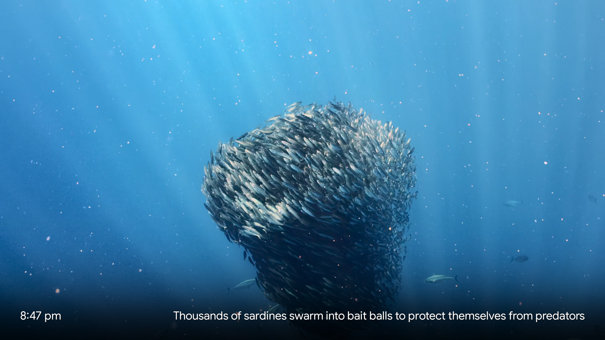

# 📺 FreeAndroid-TV-OS

[](LICENSE)
[](https://www.android.com/tv/)
[]()
[]()
[-orange.svg)]()

> Transform your sluggish, ad-bloated Google TV / Android TV into a private, blazing-fast, Apple tvOS-inspired clean entertainment powerhouse. **Zero root required. 100% reversible.**

---

## 🌟 Overview

Modern smart TVs running Google TV and OEM software have degraded into ad-injected billboards:
* Sponsored rows, banner ads, and recommendation carousels clutter the home screen.
* Unkillable background telemetry trackers collect viewing habits and device metrics.
* Aggressive OEM "memory cleaners" freeze processes, stuttering video playback.
* Commercial casting and ad-blocking apps demand subscriptions or display nag popups.

**FreeAndroid-TV-OS** is a complete, curated open-source suite and guide that replaces the stock experience with:
1. **tvOS-Inspired Clean Launcher:** Clean dock, customizable dynamic day/night ambient wallpapers, zero ads, zero recommendation feeds, and dual-category sideloaded app discovery.
2. **1-Click RAM / Cache Cleaner:** Built directly into the frosted-glass status bar pill + remote hardware keylistener to instantly free cached memory.
3. **Ad-Free YouTube with SponsorBlock:** Native 4K HDR playback bypassing video ads and auto-skipping sponsored segments.
4. **Always-On Open-Source AirPlay 2:** UxPlay-based H.264/HEVC screen mirroring and lossless ALAC/AAC audio streaming for iPhone, iPad, and Mac.
5. **Apple TV 4K Cinematic Screensavers:** Jaw-dropping 4K HDR drone, space, and underwater footage streaming directly from Apple CDNs after 90 seconds of inactivity.
6. **All-in-One Retro Gaming Console:** Full RetroArch integration pinned into the grid with Bluetooth controller support.
7. **0.5x UI Speed Boost:** Tuned window and transition animation scales for instantaneous navigation.

---

## 📸 Screenshots

| **tvOS Clean Home Dock & Custom Wallpaper** | **Pinned Grid (SmartTube, AirPlay, RetroArch)** |
|:---:|:---:|
|  |  |

| **Settings & Customization (English)** | **Apple TV 4K Cinematic Screensaver** |
|:---:|:---:|
|  |  |

---

## 🏗️ Architecture

```
+--------------------------------------------------------------------------+
|                        Apple tvOS Clean Home UI                          |
|  +--------------------------------------------------------------------+  |
|  | Status Bar: Clock, Date, Solar Pills, 1-Click RAM Cleaner          |  |
|  +--------------------------------------------------------------------+  |
|  | Dock Row (5 Cols): YouTube | Hotstar | SonyLIV | Spotify | Inputs  |  |
|  +--------------------------------------------------------------------+  |
|  | Pinned Favorites: Xiaomi TV+ | SmartTube | AirPlay | RetroArch     |  |
|  +--------------------------------------------------------------------+  |
|  | Dynamic App Discovery (Leanback + Standard Sideloaded APKs)        |  |
+--------------------------------------------------------------------------+
         |                                                 |
         v (System Management)                             v (Hardware Pipelines)
+--------------------------------------+      +----------------------------+
|         ActivityManager              |      |    MediaCodec & AudioTrack |
| - 0.5x Fast Animation Scaling        |      | - 4K HEVC / H.264 Mirroring|
| - Android 14 FGS Whitelist           |      | - Lossless ALAC & AAC Audio|
| - KillBackgroundProcesses Trigger    |      | - 4K ProRes Aerial Streams |
+--------------------------------------+      +----------------------------+
         |                                                 |
         v                                                 v
+--------------------------------------+      +----------------------------+
|         Network & Protocols          |      |     System Integration     |
| - mDNS Bonjour Discovery (Port 5353) |      | - Safe User-0 Debloating   |
| - AirPlay 2 / RAOP Server (Port 7000)|      | - DreamService Integration |
| - Client-Side Ad Parsing             |      | - Hardware Remote Remap    |
+--------------------------------------+      +----------------------------+
```

---

## 🚀 Quick Start (Automated Scripts)

All scripts are located in the [`scripts/`](scripts/) directory and can be executed from Linux or macOS terminal with `adb` installed:

```bash
git clone https://github.com/hrishikeshjh/FreeAndroid-TV-OS.git
cd FreeAndroid-TV-OS

# 1. Connect to your TV over Wireless ADB
./scripts/01_connect_wireless_adb.sh <TV_IP_ADDRESS>

# 2. Back up all properties, package states, and settings
./scripts/02_backup_tv.sh

# 3. Safely disable OEM telemetry, adware shelves, and stock launcher
./scripts/03_debloat_safe.sh

# 4. Install SmartTube (Ad-free 4K YouTube with SponsorBlock)
./scripts/04_install_smarttube.sh

# 5. Install & configure Always-On AirPlay 2 receiver
./scripts/05_setup_airplay.sh

# 6. Install & configure Apple TV 4K HDR Screensaver (90s timeout)
./scripts/06_setup_screensaver.sh

# 7. Install RetroArch TV Emulator
./scripts/07_install_retroarch.sh

# 8. Tune UI animation scales to 0.5x for 2x faster menus
./scripts/08_tune_performance.sh
```

---

## 📖 Complete Step-by-Step Guide

### Step 1: Wireless ADB Setup & Persistent Port 5555
1. On your TV, navigate to **Settings → System → About**.
2. Scroll to **Build** and tap it **7 times** until you see *"You are now a developer!"*.
3. Go back to **Settings → System → Developer options** and toggle **Wireless debugging** to **ON**.
4. Note the displayed IP address and port (e.g. `192.168.31.238:39407`).
5. Connect from your computer:
   ```bash
   adb connect 192.168.31.238:39407
   ```
6. **Crucial Step:** Lock in persistent TCP/IP port `5555` so wireless debugging never drops when the TV sleeps:
   ```bash
   adb tcpip 5555
   adb connect 192.168.31.238:5555
   ```

---

### Step 2: Safe Non-Destructive Debloating
Instead of permanently uninstalling packages (which can break OTA updates or soft-brick devices), FreeAndroid-TV-OS uses `pm disable-user --user 0`. This disables the package for the active user without touching system partitions.

```bash
./scripts/03_debloat_safe.sh
```

**Packages Disabled:**
* **Telemetry & Tracking:** `com.smartdevice.recordactivation`, `com.smartdevice.dtv.icast`, `com.google.android.feedback`
* **Sponsored Ad Shelves:** `com.smartdevice.recommendation`, `com.smartdevice.leanbacklauncher.customizer`
* **OEM Bloat & Aggressive Killers:** `com.smartdevice.aftersale`, `com.smartdevice.dailymanage`, `com.smartdevice.dailyshortcut`, `com.smartdevice.factory`, `com.Smartdevice.emanual`, `com.audiocn.karaoke.global.micmanager`, `com.loostone.tuning`
* **Stock Google TV Launcher:** `com.google.android.apps.tv.launcherx`, `com.google.android.tungsten.setupwraith`

> [!IMPORTANT]
> Essential hardware services are strictly preserved: HDMI input switching, TV Tuner (`com.mediatek.tis`), Bluetooth remote pairing (`com.google.android.tv.googletvremotepairer`), and the Google Play Store.

---

### Step 3: Building & Installing the tvOS Launcher
The launcher source is in [`launcher/`](launcher/). It is built with Android 14 SDK (API 34) and Java 21:

```bash
cd launcher
export ANDROID_HOME=~/Android/Sdk
./gradlew assembleDebug
adb install -r app/build/outputs/apk/debug/app-debug.apk
```

#### Launcher Features:
* **Custom Solar Wallpapers:** Place high-res images in `res/drawable-nodpi/wallpaper_day.jpg` and `wallpaper_night.jpg`. The launcher smoothly transitions based on real sunrise/sunset times.
* **5-Column Symmetrical Dock:** Pinned in [`config.xml`](launcher/app/src/main/res/values/config.xml):
  1. YouTube (`com.google.android.youtube.tv`)
  2. Disney+ Hotstar (`in.startv.hotstar`)
  3. SonyLIV (`com.sonyliv`)
  4. Spotify (`com.spotify.tv.android`)
  5. Inputs / HDMI Switcher (`com.gathin.tvhome.inputs`)
* **Row 2 Curated Front Apps:** Pinned in [`AppAdapter.java`](launcher/app/src/main/java/com/gathin/tvhome/AppAdapter.java):
  * **Slot 1:** Xiaomi TV+ (`com.mitv.tvhome.mitvplus`)
  * **Slot 2:** SmartTube (`org.smarttube.stable`)
  * **Slot 3:** AirPlay (`io.github.jqssun.airplay`)
  * **Slot 4:** RetroArch (`com.retroarch`)
  * Followed by all remaining Leanback and sideloaded apps alphabetically.
* **1-Click Memory Recovery:**
  * Tap the **"Clean"** frosted glass pill in the top header.
  * Or press auxiliary remote keys (Stop, Play, Guide, or Colored keys) to instantly reclaim background RAM with an on-screen toast.
* **English Localization:** Settings modal translated from the original Turkish to clean English.

---

### Step 4: Ad-Free YouTube with SmartTube
Why doesn't DNS-level ad blocking (Pi-hole, AdGuard DNS) work for YouTube?
* YouTube co-hosts video streams and video advertisements on the **exact same CDN hostnames** (`*.googlevideo.com`). Blocking the domain kills video playback entirely.
* Official YouTube TV apps enforce **TLS Certificate Pinning**, rejecting HTTPS proxy inspection.
* Read the full technical breakdown in [`docs/dns_youtube_ads_explained.md`](docs/dns_youtube_ads_explained.md).

Run `./scripts/04_install_smarttube.sh` to install **SmartTube Stable** (`org.smarttube.stable`), providing:
* Zero video ads, sponsor segment skipping, banner blocking.
* 4K 60FPS AV1/VP9 playback, HDR10+, volume normalization, and background audio.

---

### Step 5: Always-On Open-Source AirPlay 2 Receiver
Uses [android-airplay-server](https://github.com/jqssun/android-airplay-server) (GPLv3), based on **UxPlay**.

To make AirPlay truly always-on in the background on Android 14 without getting killed by App Freezer:
```bash
./scripts/05_setup_airplay.sh
```

**How It Works:**
1. Grants `SYSTEM_ALERT_WINDOW` so incoming mirroring requests automatically bring the mirror view to the front over any active app.
2. Promotes the receiver to an Android `ForegroundService` with notification channel and battery doze whitelist.
3. Broadcasts mDNS as your TV's system name (e.g. `Living room TV`).
4. Read the protocol breakdown and DRM details in [`docs/airplay_guide.md`](docs/airplay_guide.md).

---

### Step 6: Apple TV 4K HDR Cinematic Screensavers
Replaces the generic Google backdrop with Apple TV’s slow-motion 4K drone, marine life, and ISS space footage:
```bash
./scripts/06_setup_screensaver.sh
```
* Integrates directly into Android's `DreamService` (`com.neilturner.aerialviews.ui.screensaver.DreamActivity`).
* Triggers automatically after **90 seconds (1.5 minutes)** of inactivity (`screen_off_timeout = 90000`).
* Pressing any button on the TV remote wakes the TV back to the launcher instantly.

---

### Step 7: RetroArch Universal Gaming Console
Turns the TV into a classic gaming console (PlayStation 1, Nintendo 64, GBA, SNES, Arcade):
```bash
./scripts/07_install_retroarch.sh
```
* Official Android TV Leanback UI.
* Seamless pairing with Xbox, PlayStation, 8BitDo, or generic Bluetooth gamepads.

---

### Step 8: 0.5x Animation Speed Boost
Android TV transitions default to `1.0x`, which introduces perceptible input latency:
```bash
./scripts/08_tune_performance.sh
```
Sets `window_animation_scale`, `transition_animation_scale`, and `animator_duration_scale` to `0.5x`. Windows open twice as fast, menus snap immediately, and remote navigation feels instantaneous.

---

## 🔄 1-Click Rollback / Disaster Recovery

If you ever wish to revert all changes, re-enable stock Google TV LauncherX, and restore OEM packages:

```bash
./scripts/restore_all.sh
```

Everything returns to factory defaults without needing a factory reset.

---

## 📂 Repository Structure

```
FreeAndroid-TV-OS/
├── .gitignore
├── LICENSE
├── README.md
├── launcher/                  # Complete tvOS-style clean launcher project
│   ├── app/src/main/          # Source code, layouts, and drawables
│   ├── build.gradle           # Android Studio build script
│   └── build-and-install.sh   # 1-click build & deploy script
├── scripts/                   # Automated deployment & configuration tools
│   ├── 01_connect_wireless_adb.sh
│   ├── 02_backup_tv.sh
│   ├── 03_debloat_safe.sh
│   ├── 04_install_smarttube.sh
│   ├── 05_setup_airplay.sh
│   ├── 06_setup_screensaver.sh
│   ├── 07_install_retroarch.sh
│   ├── 08_tune_performance.sh
│   └── restore_all.sh
├── docs/                      # Technical deep-dives and guides
│   ├── architecture.md
│   ├── airplay_guide.md
│   ├── dns_youtube_ads_explained.md
│   └── troubleshooting.md
└── screenshots/               # High-res live captures from the TV
    ├── 01_home_dock.png
    ├── 02_apps_grid.png
    ├── 03_settings_modal.png
    └── 04_aerial_screensaver.png
```

---

## 🤝 Upstream Credits & Acknowledgments

This project builds upon the fantastic work of the open-source community:
* **[tv-vibehack](https://github.com/benfirad/tv-vibehack)** by `benfirad` - The foundational tvOS Leanback launcher concept.
* **[SmartTube](https://github.com/yuliskov/SmartTube)** by `yuliskov` - The best ad-free YouTube player for Android TV.
* **[android-airplay-server](https://github.com/jqssun/android-airplay-server)** by `jqssun` & **[UxPlay](https://github.com/FDH2/UxPlay)** - Open-source AirPlay 2 receiver engine.
* **[AerialViews](https://github.com/theothernt/AerialViews)** by `theothernt` - Apple TV 4K screensavers ported to Android.
* **[RetroArch](https://github.com/libretro/RetroArch)** by `libretro` - Multi-system open-source emulation platform.
* **[SponsorBlock](https://sponsor.ajay.app/)** by `ajayyy` - Crowdsourced sponsor segment database.

---

## ⚖️ License

Distributed under the **MIT License**. See [`LICENSE`](LICENSE) for details.
